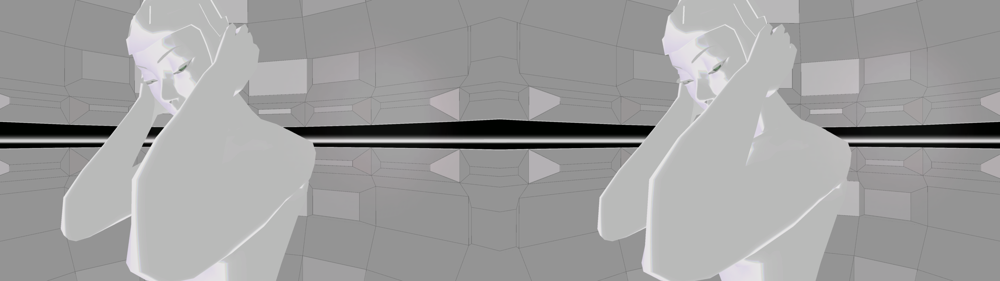
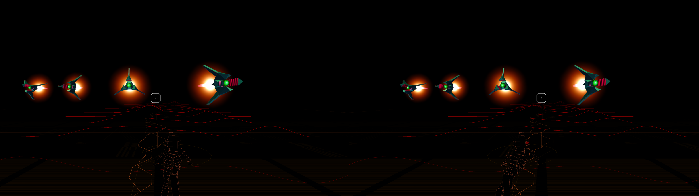

# Rez Infinite 3D

Play **Rez Infinite** in real stereoscopic 3D on a 3D monitor, 3D TV or
projector, with no VR headset needed. Separation and convergence work like
3D Vision / geo-11, so you can push the depth far past the mild VR version.

The game has a native VR renderer that draws a separate image for each eye.
This add-on replaces the game's `openvr_api.dll` with a small stand-in VR
runtime: the game believes a headset is attached, renders both eyes, and the
runtime composites them into your display's 3D format. No SteamVR, Oculus or
headset is involved, and no game files are modified. Files are only added or
swapped, with backups.




*The intro's white room and Area 1, at the default settings (separation 100 %,
convergence 20). Full side-by-side, left eye on the left: view them on a 3D
display or with the parallel free-viewing method.*

> **Unofficial fan project.** Not affiliated with or endorsed by SEGA, Enhance,
> Monstars, Resonair or Leia. It contains no game code or assets: you need your
> own copy of Rez Infinite (Steam or GOG). See [Credits](#credits).

## Requirements

- **A purchased copy of Rez Infinite from Steam or GOG**, installed by the
  store's own client. The Steam version needs Steam running and checks
  ownership as usual.
- Windows 10 or 11, a DirectX 11 GPU, and a 3D display (or Leia SR panel).

This add-on doesn't modify, bypass or replace any DRM or Steam file. It only
swaps the game's VR runtime (`openvr_api.dll`) and adds a controller DLL.

## Status: beta

Developed and tested on Rez Infinite **version 2.9** (2018 build), classic Rez.
Area X runs in 3D since v0.3.0 (before that it couldn't start in VR mode: a
black screen) but has had less testing. Reports for current Steam
and GOG builds are very welcome. Please open an issue with your store, game
version (`version.txt` in the game folder) and `REZ\rez3d.log`.

## Install

1. Download the latest release zip and extract it anywhere.
2. Run **`Rez3D.exe`**. It finds the game in your Steam libraries or GOG
   installs (or choose **browse for the game** and pick the folder that
   contains `Rez-infinite.exe`), and **install 3d** patches it.
3. The same window becomes the launcher: pick your display format and choose
   **play**. Steam must be running for the Steam version. From then on, start
   `Rez3D.exe` in the game folder.

To update, run the new release's `Rez3D.exe` the same way (**update 3d**); your
settings are kept. To remove it, choose **uninstall 3d** in the launcher (press
it twice): the original files come back. Verifying the game files in Steam/GOG
also restores the originals. A game update may do the same, so install again
afterwards.

For scripts: `Rez3D.exe --install "<game folder>"` and
`Rez3D.exe --uninstall "<game folder>" [--keep-settings]`.

What the installer touches (originals kept as `*.orig`):

| File | Purpose |
| --- | --- |
| `REZ\openvr_api.dll` | the 3D runtime (also in Area X's OpenVR folder) |
| `REZ\xinput1_3.dll` | controller bridge (also in Area X's binaries) |
| `REZ\rez3d.ini` | settings (kept on reinstall) |
| `Rez3D.exe` | settings screen and launcher |
| `steam_appid.txt` | Steam copies only. Without it the game restarts itself through Steam and drops the VR flag. Steam still checks that you own the game. |

## The launcher

`Rez3D.exe` is a settings screen in Rez's own style. Every option is saved as
you change it, and **play** starts the game in 3D. Use arrow keys, Enter and Esc,
or the mouse (click a value, right-click to decrease, scroll the wheel), or a
gamepad (d-pad, A, Start = play). A live line shows what the game receives from
your controller.

## Displays

| Display | Format |
| --- | --- |
| Passive (polarised, row-interlaced) monitor | `Interlaced` or `Interlaced_Reversed`, whichever gives correct depth with your glasses |
| 3D TV / projector, side-by-side | `SBS` |
| 3D TV / projector, top-and-bottom | `TAB` |
| DLP checkerboard | `Checkerboard` |
| Leia SR glasses-free panel (Acer SpatialLabs, Samsung Odyssey 3D, ...) | `LeiaSR` |
| Cross-eye free viewing | `SBS_Cross` |

The output is borderless fullscreen at the monitor's native resolution, drawn
inside the game's own window. Alt+Tab, focus and Alt+F4 behave like the game
normally does.

## Depth

Parallax follows 3D Vision: `parallax = Separation × (1 − Convergence / distance)`.

- **Separation** (0–200 %): how far apart distant objects are on screen;
  100 % = a real eye distance (65 mm) on your screen. The screen size is read
  from the monitor; `REZ\rez3d.log` shows it (`Screen width: … mm`) and what
  100 % means on it. If depth looks far too strong or too weak, or the size is
  wrong (some monitors report nonsense), set `ScreenWidthMM` in `rez3d.ini` to
  the visible width of your screen in millimetres. TVs and projectors often need it.
- **Convergence** (meters): the distance that sits on the screen plane. The
  avatar flies about 19 m ahead and the levels stretch hundreds of meters
  beyond. The default 20 puts the avatar on the screen and everything else
  behind it. Raise it for pop-out; much past ~30 the avatar doubles.
- **Area X convergence**: Area X is built at a closer scale (the crosshair
  about 3 m ahead, the avatar about 9 m), so it has its own setting. The
  default 3 puts the crosshair on the screen and everything else behind it.
  Area X reads only this one and Rez only Convergence; Ctrl+F7 saves the one
  in use.

Why VR Rez feels flat: at a 6.5 cm eye distance nearly everything 19 m and
farther away is effectively at infinity. Here the virtual eye distance scales
with convergence, so the whole level gets depth.

Live hotkeys in game: Ctrl+F3/F4 separation, Ctrl+F5/F6 convergence,
Ctrl+F9/F10 crosstalk, Ctrl+F7 save, Ctrl+T stereo on/off. An on-screen readout
appears while you adjust.

**Ctrl+Alt+F4 force-quits the game** from anywhere. The game's launcher keeps a
black fullscreen window on top and hides the taskbar, so if the game ever hangs,
Alt+Tab and even Task Manager stay hidden behind it. Ctrl+Alt+F4 ends every Rez
process, brings the taskbar back and restores your desktop resolution. It is
handled by a small watchdog (`Rez3D.exe --watchdog`) that the 3D runtime starts
with the game and that exits with it; it also does this on its own if the
launcher's black window is left with nothing running for 20 seconds.
`REZ\rez3d_watchdog.log` records what it did.

## Image quality on passive monitors

Each eye only gets every other row, and Rez is made of thin lines.

- **Render scale** 1.5 (default) supersamples each eye. 2.0 is sharper if
  your GPU has headroom.
- **Interlace filter** blends each eye over the rows it owns, so lines fade
  evenly instead of vanishing or flickering. 0 = sharpest, 1 = softest.
- **Crosstalk** subtracts the other eye's leak through the glasses. Raise it
  live (Ctrl+F10) until the ghost copies of bright lines disappear, then
  Ctrl+F7. Ghosts over pure black can't be subtracted unless **crosstalk lift**
  greys the black a little.
- **Brightness / gamma** compensate the light the glasses take away.

## Camera

In VR mode the camera is your head, looking straight ahead. This add-on frames
it for a monitor:

- **Lens shift** (default 7 %) with **field of view** 85° puts the Area 1
  avatar where the original game has it, fully in view in the lower half. It
  moves the picture down like a shifted camera lens, with the view kept level,
  so menus and warning panels stay rectangular (they sit 7 % lower too).
  0 is VR mode's view.
- **Follow aim** (default off) turns the view toward where you move the
  reticle, up to the set angle, like the original camera following your aim.
  It reads the same stick the game does. Try 10–15°.
- `CameraBack` and `CameraUp` in `rez3d.ini` move the viewpoint in meters, for
  experiments.

The avatar's distance doesn't change, so convergence 20 still puts it on the
screen plane.

## Leia SR (glasses-free) panels

`Format=LeiaSR` renders each eye at the panel's full resolution and hands the
side-by-side pair to the SR runtime, which weaves it for the lenses and tracks
your eyes. It needs the **SR Platform** installed (it comes with the display)
and `rez3d_leia_sr.dll`, which the release installs next to the 3D runtime.

- Without the SR Platform, or if anything in the weave fails, the game shows the
  plain side-by-side image instead of a black screen. `REZ\rez3d.log` says why
  ("Leia SR: ... presenting side-by-side").
- Render scale applies per eye, so on a 4K panel each eye is already 3840x2160
  at 1.0. Lower it if the frame rate drops.
- Crosstalk cancellation and the interlace filter are for glasses and are off
  in this mode.
- The weave is per physical pixel, so the woven image is always shown 1:1 in
  the game's window, never stretched. `REZ\rez3d.log` has a `Leia SR geometry`
  line (display mode, DPI, the window the weaver uses, the 3D view and the
  swapchain) and names anything that doesn't line up.
- Testers: `REZ3D_DISABLE_LEIA_WEAVE=1` forces the side-by-side fallback, and
  `LeiaWindow=own` hands the weaver the 3D view instead of the game window.
  `DumpFrames=2`, `DumpAfterSec=40`, `DumpEverySec=5` capture the woven output
  (`rez3d_frame_*.bmp`) and the full-resolution pair the weaver received
  (`rez3d_pair_*.bmp`).

**Status:** the fallback is verified. In the first SpatialLabs tests (v0.2.0)
the panel switched to 3D but both eyes saw both views, and plain side-by-side
showed the same: depth several times stronger than intended, far more than a
weave can separate. The likely cause is a wrong screen size read from the
monitor, which v0.3.0 now checks and logs (see Depth; `ScreenWidthMM` overrides
it). v0.3.0 also shows the weave 1:1, logs its geometry and fixes the hotkeys,
so convergence and separation respond again. If you own an SR panel, please
open a **Leia SR test report** issue (the form lists what to include).

## Controllers

Rez only reads Xbox-style (XInput) pads. The included `xinput1_3.dll` also
bridges any other pad Windows sees, such as Logitech Dual Action/F310 (D mode),
DualShock 4, Switch Pro and generic USB pads, when no Xbox pad is connected.

- **Stick speed** (default 60 %) and **stick curve** (default 1.5) make the
  reticle slower and finer than the game's own slowest cursor setting. They
  apply to all pads; 100 % and 1.0 give the stick's raw response.
- Wrong button? Override it in `rez3d.ini` with the 1-based button number:
  `PadA`, `PadB`, `PadX`, `PadY`, `PadLB`, `PadRB`, `PadLT`, `PadRT`,
  `PadBack`, `PadStart`, `PadLS`, `PadRS`, right-stick axes `PadRightX=Z`,
  `PadRightY=R`, plus `PadDeadzone=15` and `PadBridge=0` to turn the bridge off.
- Keyboard, while the game is focused: Enter/Space/Z = A, X/Esc = B, C = X,
  V = Y, Q/E = shoulders, Backspace = Back, arrows = d-pad, WASD = left stick,
  IJKL = right stick.

`REZ\xinput_proxy.log` shows which controller was bridged.

## All settings

Everything lives in `REZ\rez3d.ini`, with comments. A copy sits in Area X's
OpenVR folder. The launcher covers the common ones. Others:

| Key | Meaning |
| --- | --- |
| `Monitor` | 0-based display index |
| `VSync`, `FramePacing` | sync to the display; hold the game to its refresh like a VR compositor |
| `FPS` | refresh rate reported to the game (0 = the monitor's) |
| `UnmuteOnStart` | 1 = clear a mute Windows remembered for the game in the volume mixer |
| `LeiaWindow` | Leia SR: `top` (the game's window, default) or `own` |
| `MenuSeparation` | experimental: lower separation in detected menus (-1 = off; can misfire) |
| `LensShift`, `CameraBack`, `CameraUp` | framing and viewpoint (see Camera) |
| `FollowAim`, `FollowSpeed` | view follows the reticle (see Camera) |
| `Tracking` | `mouse` = experimental mouse head-look |
| `GpuComposite` | 0 = slower CPU fallback |
| `LogFrameCalls`, `DumpFrames`, `DumpAfter`, `DumpEvery`, `DumpAfterSec`, `DumpEverySec` | debugging (frame dumps by frame count or by seconds) |

## Known limitations

- The warning screen, logos and menus are flat panels the game draws for VR.
  They sit far behind the screen at full separation.
- The HUD (reticle, lock-on markers) lives in the 3D scene, so it moves in
  depth with everything else.
- Area X is less tested. In one test it ran out of enemies after a few
  minutes. Area X may expect you to turn your head as in VR, and the view here
  always looks ahead; `Tracking=mouse` in Area X's `rez3d.ini` lets you look
  around with the mouse (experimental) while this is investigated.

## Building from source

Needs Visual Studio 2022 or its Build Tools (C++ workload, Windows SDK) and CMake.

```
powershell -ExecutionPolicy Bypass -File .\build.ps1 -Version 0.1.0
```

This builds the runtime, the controller bridge and the launcher, and writes
`dist\rez-infinite-3d-0.1.0.zip`. `build\launcher\Rez3D.exe` carries the
other files inside it and installs them like the release does;
`install.ps1` / `uninstall.ps1` also work straight from a source build.

The Leia SR loader (`leia/`, `rez3d_leia_sr.dll`) also needs a checkout of
[SR-lib](https://github.com/bo3b/SR-lib) on branch `api_expansion`, commit
`0c80cc01f671e1491ea70f8f9c2358ff938a6503`, which vendors the Leia SR SDK
1.34.10. Pass it with `-SrLib <path>`, set `REZ3D_SRLIB`, or put it in
`third_party\SR-lib`. It is never committed. Without it the build skips the
loader, and `Format=LeiaSR` falls back to side-by-side. The loader delay-loads
every SR DLL, so it loads on machines without the SR Platform.

Layout: `src/` holds the VR runtime and 3D compositor (D3D11, shared textures,
HLSL composite), `xinput-proxy/` the controller bridge, `launcher/` the
settings screen (C#), `leia/` the optional Leia SR loader, and `vendor/` the
OpenVR 1.0.2 C API header.

Testing without taking over your screen: `build\tools\RunHidden.exe 30
"<game>\Rez-infinite.exe" vr=1` runs the game on a hidden Windows desktop,
renders off-screen and mutes it. Combine it with `DumpFrames` for captures and
`REZ\rezpad.txt` (write `A`, wait 0.4 s, clear, repeat) to step through the
menus. `tools\visible_windows.ps1` checks that nothing appeared on your desktop.

How it works, briefly:

- Each eye is offset by `sep × conv × tanH` and its frustum is shifted by
  `sep × tanH`, which is 3D Vision's clip-space `x += sep × (w − conv)` with
  convergence in meters.
- `WaitGetPoses` paces the game to the display like a VR compositor.
- The eye textures go through keyed-mutex shared textures to a compositor
  thread on its own device.
- That thread's swapchain is a child of the game's own window, covering the
  game's flat one-eye mirror.

## Credits

**Rez** was created by **Tetsuya Mizuguchi**, developed by United Game
Artists and published by **SEGA** in 2001. **Rez Infinite** is by **Enhance**,
with **Monstars** and **Resonair**. All credit for the game goes to them. This
add-on only changes how its picture reaches your eyes.

Rez is its music. Thanks to sound creator **Keiichi Sugiyama** and the
soundtrack's artists, among them **Ken Ishii**, **Mist**, **Joujouka**,
**Adam Freeland** and **Coldcut**, and to **Hydelic** for Area X.

Stereo 3D:

- **bo3b**: SR-lib, which the Leia SR mode is built on, and years of
  stereo 3D modding work
- **oneup03**: the RT64 3D work that the Leia SR approach follows
- **masterotaku**: Leia SR panel testing and feedback that shaped how this
  mode works
- The NVIDIA 3D Vision and geo-11 community, whose separation and
  convergence conventions this add-on follows

## Licence

MIT. See `LICENSE`. The OpenVR header is © Valve (BSD-3-Clause); see
`THIRD_PARTY_NOTICES.md`.
